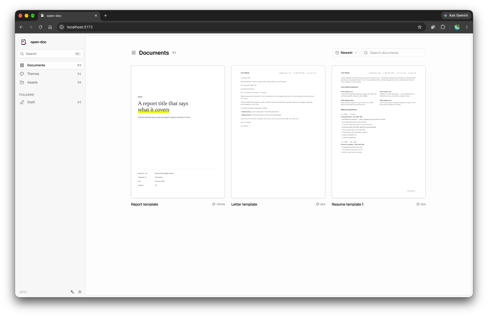

# open-cv

open-cv is a resume and cover letter builder. Each document is a React component rendered onto a fixed **A4 page (794 × 1123 px)**, so layout, spacing and print output are exact instead of fighting a Word template. You paste in the resume you already have and a coding agent turns it into a Markdown file and a laid-out page, then keeps the two in step as you edit in the visual editor or in chat. It exports to PDF, Word and HTML.



Built on [open-slide](https://github.com/open-slide/open-slide) by [Yiwei Ho](https://github.com/1weiho).

## What's different from open-slide

open-cv started as a fork of open-slide, which is built for presentations. The editor looks familiar on purpose. What changed is what's underneath:

- **Documents, not slides.** Pages are A4 portrait (794 × 1123 px) instead of 16:9, and a resume or cover letter is a few Pages in a row. Present mode shows a Page at full size and scrolls, like reading a document.
- **Layout and content content kept in sync.** Each document has its words as Markdown (the Content) and its look as a page file (the Layout). Skills import a resume you already have, sync the two, and tell you when they have drifted apart.
- **Exports for job applications.** The PDF and Word files are ATS ready. The Word export is new and is built from the Content. PowerPoint export and speaker notes are removed, because a resume doesn't need them.
- **Agent skills written for a4 documents.** The instructions your coding agent follows describe a document page (type sizes, spacing, how bullets are built) and content (import, sync, apply layout comments), instead of building a deck. The model itself is unchanged. The skills guide it.

The full list, and how to take updates from open-slide, is in [docs/FORK.md](docs/FORK.md).

## Get started

You need [Node.js](https://nodejs.org) 20.19+ (or 22.12+) and [pnpm](https://pnpm.io).

```bash
git clone https://github.com/yamhochi/open-cv.git
cd open-cv
pnpm install
pnpm sync:skills
pnpm dev
```

Open the address `pnpm dev` prints (usually <http://localhost:5173>). You will see the two Templates, a placeholder resume and a placeholder cover letter. The steps below turn them into yours.

## How to use it

Open the project in Claude Code (or another coding agent that reads `.claude/skills`) and talk to it. Each resume is two files that carry the same words: the **Content** (`docs/resumes/<id>.md`, plain Markdown) and the **Layout** (`slides/<id>/index.tsx`, the page file the editor shows). The skills keep them in step. The terms are defined in [`CONTEXT.md`](./CONTEXT.md).

### 1. Start from the resume you already have

Say **"import my resume"** and paste it, or give a path to a PDF or text file.

- The `import-resume` skill writes your words into `docs/resumes/resume.md`, keeping your wording and only putting it into the fixed Markdown shape. It tells you anything it could not place cleanly.
- It then hands over to `sync-resume`, which builds the Layout from that Content, fits it onto A4 Pages and checks it.
- Open the editor to see it. Read the Markdown first if you want to correct anything before the layout is built.

### 2. Keep chatting to change it

Ask for changes in plain language: "shorten the summary", "put the second role on page two", "make the section headings smaller". Wording changes go to the Content and are synced into the Layout. Visual changes go straight to the Layout.

You can also edit in the editor yourself by double-clicking text. The Markdown is then out of date, which the project calls **Drift**. Say **"sync"** and `sync-resume` finds which side changed and brings the other into line. It asks you before overwriting anything if both changed.

Only use facts that you can stand behind.

### 3. Comment on the layout

For layout and styling changes, leave a comment instead of describing the change in chat. In the editor, click an element on the page, open **Comment** in the Format panel, describe the change ("make this heading smaller", "more space above this section", "keep these two columns level") and add it. Leave as many as you like, then say **"apply comments"** (or run `/apply-comments`). The `apply-comments` skill makes the changes to the Layout and clears the comments.

Comments are there to help with the layout. They are not for writing your resume.

### 4. Check and export

- **Download** in the editor toolbar exports a PDF. The menu also has Word and HTML. PDF export needs a Chromium-based browser.
- **ATS ready.** The PDF and Word files are built to be read by applicant tracking systems: real selectable text in a clean reading order, fonts embedded, and bullets drawn as shapes so they add no stray characters.
- The PDF comes from the Layout, and the Word file comes from the Content, so run a sync first if you have edited in the editor. `pnpm resume:check <id>` tells you whether they match.

| You say | Skill | What it does |
| --- | --- | --- |
| "import my resume" | `import-resume` | Pasted or file resume in, Content out, then a sync. |
| "sync" or "I edited it in the editor" | `sync-resume` | Finds the side that changed and updates the other. |
| "apply comments" | `apply-comments` | Makes the layout changes you left as comments in the editor. |

Everything else is ordinary chat: "move this", "reword that", "add a link".

## Scripts

| Command | Description |
| --- | --- |
| `pnpm dev` | Start the editor with hot reload. |
| `pnpm build` | Build a static bundle you can deploy. |
| `pnpm preview` | Preview the built bundle locally. |
| `pnpm sync:skills` | Copy the skills from `framework/core/skills/` into `.claude/skills` and `.agents/skills` for your coding agent. |
| `pnpm resume:check <id>` | Report whether the Content and Layout match (exit 1 on drift). |
| `pnpm resume:pull <id>` | Rewrite the Content from the Layout, to absorb editor edits. |
| `pnpm export:docx <id> [out.docx]` | Build a Word file from the Content. The files are git-ignored. |

## How a resume is written

`slides/resume/index.tsx` default-exports an array of page components, one per A4 page:

```tsx
import type { Page, SlideMeta } from '@open-slide/core';

const ResumePage: Page = () => (
  <div style={{ width: '100%', height: '100%', padding: 48, boxSizing: 'border-box' }}>
    Your resume here
  </div>
);

export const meta: SlideMeta = { title: 'Resume' };
export default [ResumePage] satisfies Page[];
```

- **The page is fixed at 794 × 1123.** Content past the bottom edge is cropped, so when a section overflows, move whole entries to the next page.
- **Use pixel values** for type and spacing (the template uses 12px body text and 48px padding).
- **Build bullets as components.** Write each bullet as `<Bullet label="…">` with nested `<SubBullet text="…" />` children. Don't use one paragraph or a `.map()`. This keeps every line separately editable in the visual editor.
- **Assets** (a headshot, for example) go in `slides/resume/assets/`.

[`AGENTS.md`](./AGENTS.md) has the full rules for coding agents.

## Present mode

Present mode shows the page at 100% (794px wide on screen), centered. Scroll to see the rest of the page. Use the left and right arrow keys to change pages.

## Credits and license

MIT. This project includes code from [open-slide](https://github.com/open-slide/open-slide) (MIT, © Yiwei Ho); see [`framework/core/LICENSE`](./framework/core/LICENSE). What was changed, and how to pull in upstream updates, is in [docs/FORK.md](docs/FORK.md).
